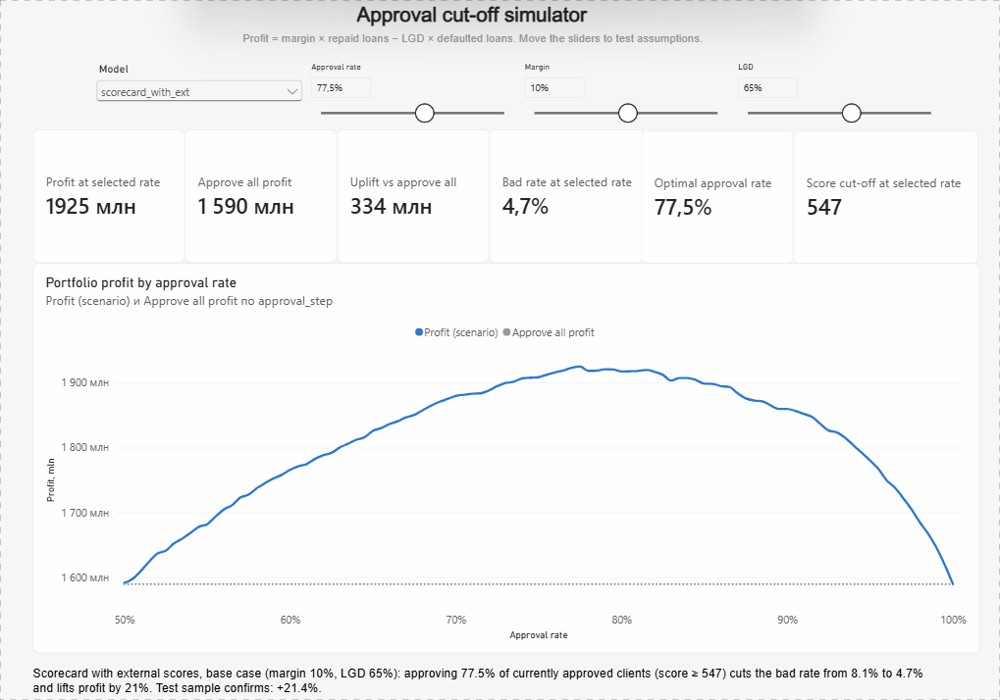
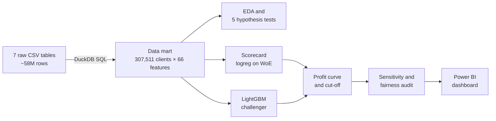
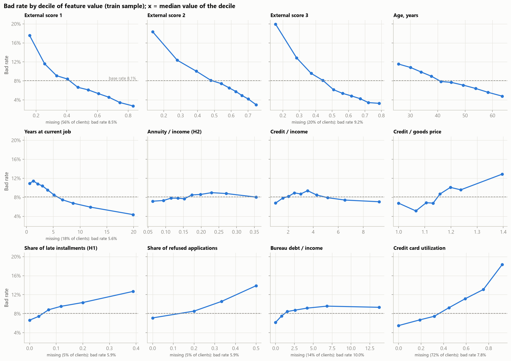
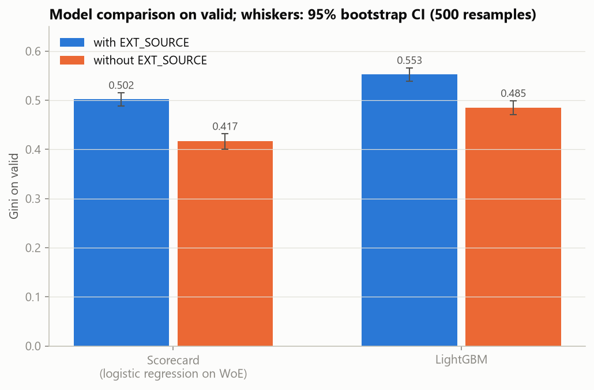
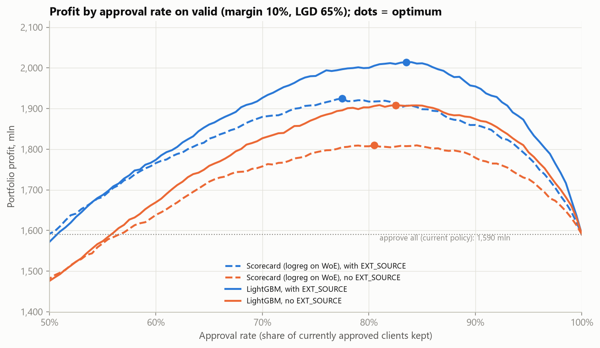
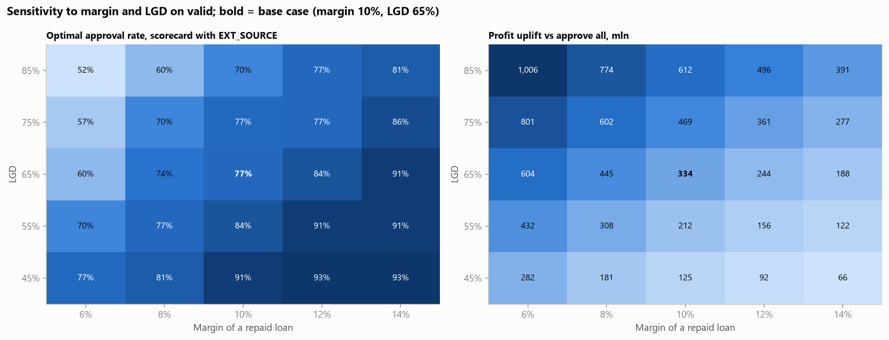
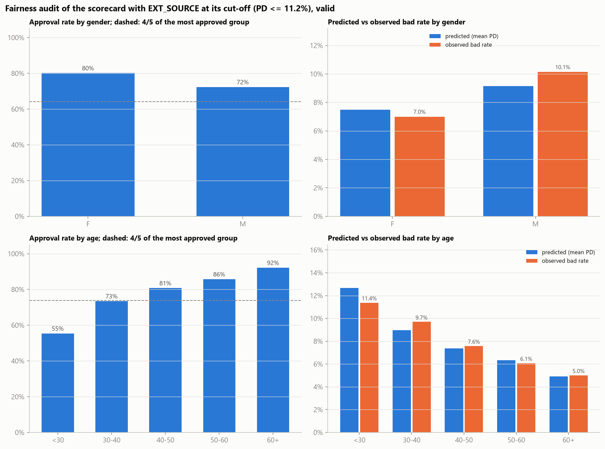

# Credit Scoring: Which Loans Should a Bank Approve?


A bank issues consumer loans and about 8% of clients have payment problems. This project builds a
credit scorecard on the [Home Credit Default Risk](https://www.kaggle.com/c/home-credit-default-risk) data
and turns it into a business decision: **which applications to approve so that the portfolio earns the most**.

## TL;DR

On the held-out test sample, the scorecard with the cut-off chosen on the validation sample delivers:

| | Approve everyone (current policy) | Scorecard cut-off (score ≥ 547) |
|---|---|---|
| Approval rate | 100% | **77.4%** |
| Bad rate of approved loans | 8.1% | **4.7%** |
| Portfolio profit* | 1,613 M | **1,959 M (+346 M, +21.4%)** |
| Gini | – | **0.509** |

\* Margin 10% on a repaid loan, loss of 65% (LGD) of a defaulted loan; amounts in the loan currency of the
dataset. The conclusion holds in all 25 tested margin × LGD scenarios, see [Economics](#4-economics-choosing-the-cut-off).



*Power BI cut-off simulator: pick a model, an approval rate, a margin and an LGD. Profit, bad rate and the
score cut-off update instantly.*

## Key findings

- **A simple scorecard captures most of the value.** It lifts profit by 21%. A LightGBM model adds another
  70 M on test, which is the **price of explainability**. The scorecard stays the main model because every
  decision can be explained in points per feature.
- **External credit scores pay off.** Without `EXT_SOURCE_1/2/3` the scorecard loses 0.086 Gini and 120 M
  of profit, which is about 1,950 per application. A bureau query is worth buying below that price.
- **The decision is robust, the cut-off is not.** The model beats "approve everyone" in all 25
  margin × LGD scenarios (+66 M to +1,006 M), but the optimal approval rate moves from 52% to 93%.
  The cut-off is a business parameter, recomputed when pricing or recovery changes.
- **The profit curve has a flat top.** Approval rates from 77% to 84% are within 1% of the optimum, so
  the simple break-even rule "PD < margin / (margin + LGD) = 13.3%" costs only 1% of profit.
- **Defaulted loans are larger.** Within every PD decile, defaulted loans have a higher amount than repaid
  ones, so money losses are higher than the PD calibrated on client counts suggests.
- **Fairness.** Gender passes the four-fifths rule (adverse impact ratio 0.90). Clients under 30 do not
  (approved 55% vs 92% for 60+, ratio 0.60). Most of the gap is real risk (bad rate 11.4% vs 5.0%), but the
  scorecard over-predicts their PD by 11%: a recalibration by age group is the next step.

## Approach



Train / validation / test split 60 / 20 / 20, stratified by the target. Everything that learns from data
(bins, WoE, feature selection, model, cut-off) is fitted on train or chosen on validation. The test sample is
opened once, at the end.

### 1. Data mart in SQL

Seven Home Credit tables (applications, credit bureau, previous applications, installments, POS and card
balances) are aggregated to one row per client with DuckDB SQL: [`sql/`](sql/).

- Each source is aggregated to the client level before joining, so joins cannot multiply rows.
- Every feature table is reconciled with its source (the same total computed two ways).
- Missing history is kept as `NULL` plus a `has_*_history` flag instead of being filled with zeros.

Data model: [`docs/data_model.md`](docs/data_model.md).

### 2. Exploratory analysis and hypotheses

Five hypotheses tested with z-tests for proportions and Mann–Whitney U, Holm correction. With 185k clients
everything is significant, so the hypotheses are ranked by effect size, not p-value.

| Hypothesis | Bad rate | Effect |
|---|---|---|
| Refused an application in the last year | 11.8% vs 7.5% | × 1.58 |
| Paid late on a previous Home Credit loan | 9.5% vs 6.7% | × 1.42 |
| Thin credit file | 10.0% vs 7.8% | × 1.29 |
| Age: under 30 vs 60+ | 11.4% vs 4.9% | AUC 0.42 |
| Debt-to-income burden | – | AUC 0.52, no practical effect* |

\* Only approved clients are in the data: the bank already rejected high-burden applicants (selection bias).



### 3. Scoring models

**Scorecard.** Each feature is split into monotonic bins and replaced by its Weight of Evidence. Features are
selected by Information Value (IV ≥ 0.02) and correlation (≤ 0.7). A logistic regression is refit until every
coefficient has the expected sign. Scores use a points scale: 600 points = odds 50:1, +20 points double the odds.
24 features: [`docs/FEATURES.md`](docs/FEATURES.md).

**LightGBM** as a challenger, with shallow trees (7 leaves, 1,000 clients per leaf) to keep it stable.

Both models are trained with and without the external scores `EXT_SOURCE_1/2/3`.



<details>
<summary>All four models: Gini, cut-off and test profit</summary>

| Model | Gini valid [95% CI] | Gini test | Approval rate | Bad rate of approved | Profit uplift on test |
|---|---|---|---|---|---|
| **Scorecard, with EXT_SOURCE (main)** | 0.502 [0.489; 0.515] | 0.509 | 77.4% | 4.7% | +346 M (+21.4%) |
| Scorecard, no EXT_SOURCE | 0.417 [0.401; 0.432] | 0.423 | 80.7% | 5.6% | +226 M (+14.0%) |
| LightGBM, with EXT_SOURCE | 0.553 [0.538; 0.566] | 0.556 | 83.5% | 4.9% | +416 M (+25.8%) |
| LightGBM, no EXT_SOURCE | 0.485 [0.471; 0.499] | 0.493 | 82.5% | 5.3% | +314 M (+19.5%) |

- All four models are well calibrated (mean PD ≈ observed bad rate), so their PD can be used for money.
- The LightGBM − scorecard difference is +0.051 Gini [0.044; 0.058] by bootstrap: the gap is real.
- LightGBM without external scores ≈ scorecard with them: external data and model complexity substitute
  each other.

Also: [ROC curves](reports/figures/03_roc_curves.png), [calibration](reports/figures/03_calibration.png),
[SHAP importance](reports/figures/03_shap_importance.png), [IV](reports/figures/03_information_value.png),
[score distribution](reports/figures/03_score_distribution.png).
</details>

### 4. Economics: choosing the cut-off

Each approved loan earns `amount × margin` if repaid and loses `amount × LGD` if not. Sorting clients
from the safest and approving more of them traces a profit curve. Its top is the optimal cut-off: the point
where the next client starts to lose money on average.



The cut-off is chosen on the validation sample and then checked on test: it loses less than 1% of profit
compared with the best cut-off picked in hindsight.

<details>
<summary>Sensitivity to margin and LGD</summary>



The scorecard beats "approve everyone" in every scenario. Its value grows when conditions get worse (lower
margin, higher LGD). A conservative scenario with a margin of 8% approves 74% and adds 445 M.
</details>

### 5. Fairness audit

Approval rate, adverse impact ratio (four-fifths rule) and predicted vs observed bad rate by gender and age,
at the chosen cut-off. Gender is not a model feature, and age enters the scorecard only through proxies.



## Dashboard

Two Power BI pages for a risk manager, built on aggregated tables only
([`reports/powerbi/`](reports/powerbi/), file `credit_risk.pbix`):

- **Cut-off simulator** (animated at the top of this page): profit, bad rate and score cut-off for any model,
  approval rate, margin and LGD;
- **Fairness audit** ([screenshot](reports/figures/05_dashboard_fairness.png)): approval rate, adverse impact
  ratio and calibration by age or gender for the selected model.

## Limitations and assumptions

- **Selection bias.** The data contains only loans the bank approved. The model ranks within that
  population, and "approval rate" means the share of currently approved clients kept (an overlay on the
  existing policy). Rejected applicants cannot be evaluated without reject inference.
- **No real pricing or recovery data.** Margin and LGD are assumptions, so the sensitivity grid matters
  more than the base-case number. Exposure is the full loan amount; amortisation is ignored.
- **No calendar time.** The data has no application dates, so there is no out-of-time validation and no
  stability (PSI) check over time.
- **Target definition.** `TARGET` means "payment difficulties", not the regulatory 90+ days past due default.
- **Calibration by counts, not money.** PD is calibrated on client counts, while defaulted loans are larger
  than repaid ones with the same PD, so money losses are underestimated.

## Repository structure

```
sql/                 DuckDB feature tables, one file per source (10_ ... 70_data_mart)
notebooks/           01 data mart → 02 EDA → 03 models → 04 economics → 05 dashboard data
src/                 woe.py, scorecard.py, modeling.py, economics.py, viz.py
tests/               pytest unit tests for WoE, scorecard, modeling and economics
reports/figures/     all charts used here
reports/powerbi/     aggregated CSV tables and the Power BI report
docs/                feature list, data model, glossary and progress notes (in Russian)
```

## How to reproduce

1. Download the competition data from [Kaggle](https://www.kaggle.com/c/home-credit-default-risk/data)
   and put the CSV files into `data/raw/` (the data is not redistributed here).
2. Create the environment:
   ```bash
   python -m venv .venv
   .venv\Scripts\activate        # Windows; source .venv/bin/activate on Linux/macOS
   pip install -r requirements.txt
   ```
3. Run the notebooks in order `01` → `05`. Notebook `01` loads the CSVs into `data/home_credit.duckdb` and
   runs the SQL files; the following ones read the saved data mart, models and predictions.
4. Run the tests: `pytest`.
5. Open `reports/powerbi/credit_risk.pbix` in Power BI Desktop. If the paths differ, point the six CSV
   sources to `reports/powerbi/`.

All random seeds are fixed (`random_state = 42`).

## License

Code: [MIT](LICENSE). Data: Home Credit Default Risk, Kaggle competition rules.
