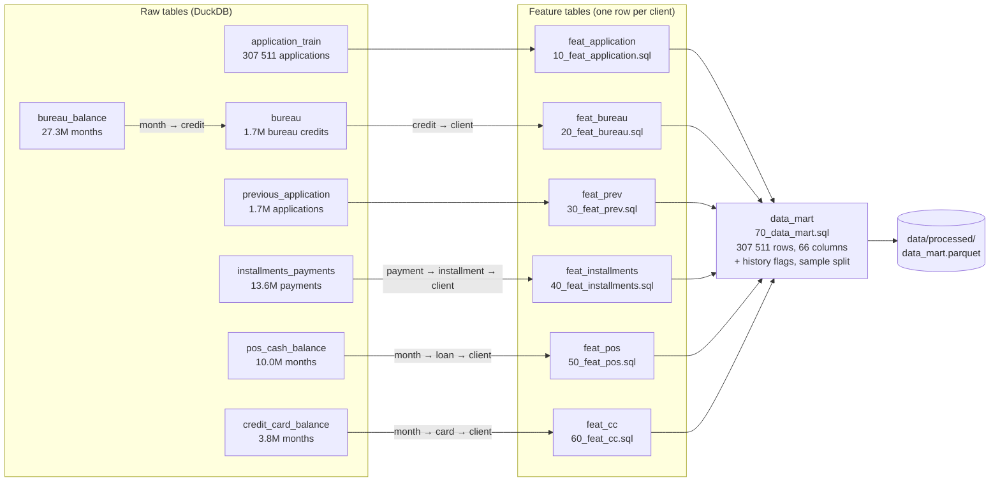

# Модель данных

Raw-таблицы Home Credit агрегируются до зерна клиента (`SK_ID_CURR`) отдельными SQL-файлами,
затем соединяются LEFT JOIN в витрину `data_mart` (307 511 строк, одна строка на заявку из
`application_train`). Каждая таблица признаков уже на зерне клиента, поэтому джойн не размножает строки.

## Таблицы признаков

| Таблица | Клиентов | Покрытие | Сверка с источником |
|---|---|---|---|
| feat_application | 307 511 | 100% | — |
| feat_bureau | 263 491 | 85.7% | 1 465 325 кредитов |
| feat_prev | 291 057 | 94.7% | 1 413 701 заявка |
| feat_installments | 291 643 | 94.8% | 11 026 627 взносов |
| feat_pos | 289 444 | 94.1% | 8 543 375 месяцев |
| feat_cc | 86 905 | 28.3% | 3 227 965 месяцев |

## Разбиение выборки

Столбец `sample`: train 184 506 (60%), valid 61 502 (20%), test 61 503 (20%).
Bad rate 0.0807 во всех трёх частях (стратификация по `TARGET`).
