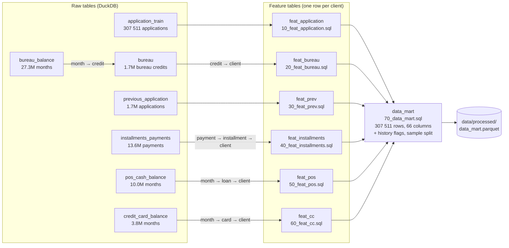

# Модель данных

Каждая исходная таблица сводится до одной строки на клиента своим SQL-файлом, затем всё собирается
в витрину `data_mart`: 307 511 клиентов, 66 столбцов.

| Таблица признаков | Клиентов | Доля от всех |
|---|---|---|
| feat_application | 307 511 | 100% |
| feat_bureau | 263 491 | 85.7% |
| feat_prev | 291 057 | 94.7% |
| feat_installments | 291 643 | 94.8% |
| feat_pos | 289 444 | 94.1% |
| feat_cc | 86 905 | 28.3% |

Разбиение: train 184 506, valid 61 502, test 61 503 (60 / 20 / 20), доля дефолтов 8.07% в каждой части.
